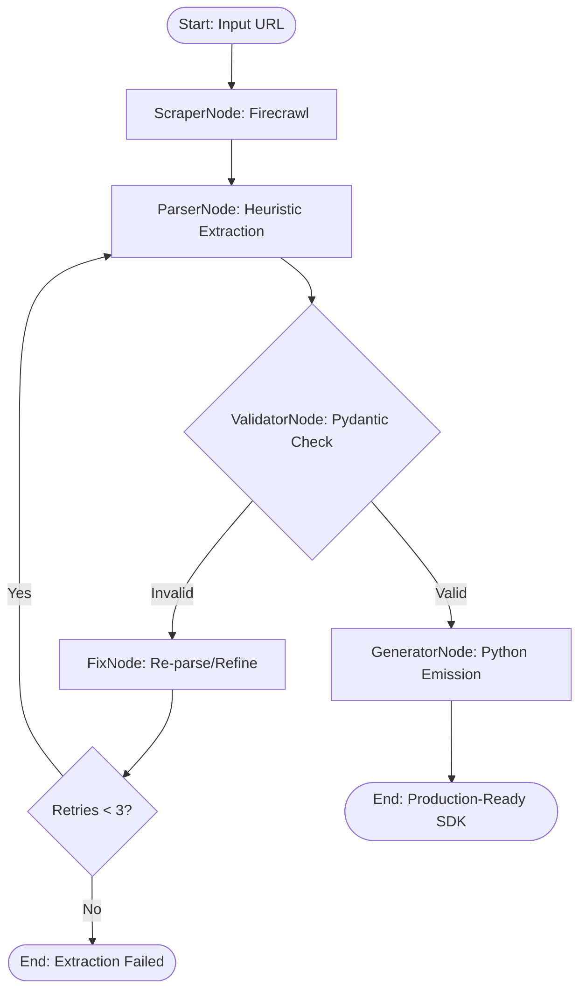

# Auto-SDK Architect

### *Automated, Deterministic API Client Generation via Agentic Heuristics*

**Auto-SDK Architect** is a stateful orchestration engine that turns an API documentation URL into a production-ready, type-safe Python SDK — deterministically, in under 90 seconds, with clean bounded failure when docs are too messy to parse.

Unlike standard LLM-based code generators that suffer from stochasticity and hallucination, this system uses a **"Deterministic Synthesis"** pattern: intelligent heuristics for extraction, strict schema validation for integrity, and **plain-Python code emission** for generation. There is no LLM in the code-generation path.

---

## 🚀 The Problem

Integrating a third-party API is a manual, repetitive process. Developers must parse documentation, map endpoints, and hand-write boilerplate — days of work per API, prone to typos and silent field-name mismatches.

The two common alternatives both fail:

* **Direct LLM code generation** is non-deterministic: run it twice, get two different SDKs. It invents parameters that don't exist and breaks silently in production.
* **Manual extraction** is slow, boring, and error-prone at scale.

## 💡 The Solution: Deterministic Synthesis

Auto-SDK Architect implements a **multi-stage state machine** that treats documentation as a **data-extraction problem**, not a creative-writing problem. By decoupling **Semantic Extraction** from **Code Synthesis**, and by making the codegen step a pure function of a validated schema, we guarantee:

* **Same input → identical output, byte-for-byte.**
* **No invented fields.** Code is emitted from a Pydantic-validated schema.
* **Clean, bounded failure.** If a doc cannot be parsed after N retries, the pipeline stops with an explicit error — never an infinite loop.
* **Full observability.** Every node writes to a shared **Scratchpad**; the UI renders the pipeline's reasoning as it happens.

---

## 🏗️ System Architecture

### 1. Orchestration Layer (LangGraph)

The "brain" is a **LangGraph StateGraph** embedded inside FastAPI. It manages the lifecycle of a generation job: state transitions, conditional routing (valid → generator, invalid → fix), and bounded retry handling. A SQLite checkpointer persists every run.

### 2. Extraction Layer (Firecrawl + Heuristics)

* **Discovery:** Firecrawl performs structured scraping to ingest raw documentation.
* **Heuristic Parser:** Context-aware pattern matching identifies API paths, HTTP methods, and parameter schemas. No LLM.

### 3. Validation Layer (Pydantic v2)

All extracted data passes through a strict **Pydantic schema contract** (`Param`, `Endpoint`, `ExtractionSchema`). If the extracted data violates type-safety, the graph routes to the `FixNode` for a targeted re-parse.

### 4. Synthesis Layer (Plain Python)

The final SDK is emitted by a **pure Python function** that walks the validated `list[Endpoint]` and assembles the source with f-strings. Same schema in → same file out.

### 5. Observability Layer (The Scratchpad)

Every node appends a timestamped entry to a single append-only list in the graph state — the **Scratchpad**. This list is the canonical narration of the pipeline: every number the UI displays traces back to a node that computed it. There is no separate event channel, no WebSocket, no fake progress bar — the Scratchpad *is* the feed.

**Two rules keep it honest:**

1. **No fabricated payloads.** Every field in a Scratchpad entry must be computed by the node that wrote it. The `ParserNode` writes `endpoint_count = len(endpoints)`, not a constant.
2. **The reducer annotation is mandatory.** `scratchpad: Annotated[list[ScratchpadEntry], operator.add]` — without it, LangGraph overwrites the list on each node write and all but the last entry are lost.

---

## 🛠️ Technical Stack

| Layer | Technology | Purpose |
| :--- | :--- | :--- |
| **Frontend** | React + Vite + Tailwind CSS | UI; renders the Scratchpad |
| **API** | FastAPI + uvicorn | JSON routes |
| **Orchestration** | LangGraph | Stateful agentic workflow (in-process) |
| **Job Runner** | FastAPI `BackgroundTasks` | Non-blocking job execution |
| **State Store** | SQLite (LangGraph checkpointer) | Job persistence incl. Scratchpad |
| **Scraping** | Firecrawl | Structured web data ingestion |
| **Validation** | Pydantic v2 | Schema integrity and type-safety |
| **Codegen** | Plain Python (f-strings) | Deterministic SDK emission |
| **Config** | `pydantic-settings` + `.env` | Secrets management |

---

## 🔄 Workflow (The State Machine)



**Why the retry is bounded:** the only non-determinism in the pipeline is the retry cycle. Bounding it at N=3 makes the graph a DAG with a single bounded cycle — the pipeline **provably terminates**, either at a downloadable SDK or at an explicit extraction-failure terminal.

Each node in this graph calls `append()` exactly once (twice for `ValidatorNode`, once per pass). That's the entire instrumentation footprint.

---

## 🌟 Key Engineering Features

* **Zero-Hallucination Guarantee** — codegen is a pure function of a validated schema; there is no LLM in the generation path.
* **Bounded Fault Tolerance** — the `FixNode` recovers from schema drift up to 3 times, then fails cleanly. No infinite loops.
* **Determinism Test** — a CI test asserts that invoking the graph twice on the same URL produces byte-identical SDK output *and* identical Scratchpad payloads (timestamps excluded).
* **Observable Reasoning** — the Scratchpad narrates every node transition with real, computed values. The UI is a live view of the agent's actual work, not a mock.
* **Type-Safety** — generated clients use strict Python type hints, validated against MyPy in CI.
* **Compiles-by-Construction** — the generator is tested against `compile(code, ...)` on every run.

---

## 🚦 Getting Started

### Prerequisites

* Python 3.10+
* Node.js 18+ & npm
* A [Firecrawl API key](https://firecrawl.dev)

### Environment

Create a `.env` file at the project root:

```env
FIRECRAWL_API_KEY=your_key_here
DATABASE_URL=sqlite:///./jobs.db
```

### Backend

```bash
python -m venv venv
source venv/bin/activate        # Windows: venv\Scripts\activate
pip install -r requirements.txt
uvicorn app.main:app --reload
```

### Frontend

```bash
cd frontend
npm install
npm run dev
```

Open `http://localhost:5173`, paste a docs URL, and generate.

---

## 🔌 API Surface

| Method | Path | Purpose |
| :--- | :--- | :--- |
| `POST` | `/generate` | Submit a docs URL, start a job → `202 { job_id }` |
| `GET` | `/jobs/{id}` | Poll status → `{ status, sdk_url, scratchpad }` |
| `GET` | `/jobs/{id}/sdk` | Download the generated `.py` SDK |
| `GET` | `/health` | Liveness probe |

### Job status shape

```json
{
  "job_id": "abc-123",
  "status": "success",
  "sdk_url": "/jobs/abc-123/sdk",
  "scratchpad": [
    { "step": 1, "node": "ScraperNode",   "event": "scrape.complete",   "ts": "...", "payload": { "bytes": 409600 } },
    { "step": 2, "node": "ParserNode",    "event": "parse.complete",    "ts": "...", "payload": { "endpoint_count": 87 } },
    { "step": 3, "node": "ValidatorNode", "event": "validate.fail",     "ts": "...", "payload": { "valid_count": 79, "invalid_count": 8, "errors": ["..."] } },
    { "step": 4, "node": "FixNode",       "event": "fix.attempt",       "ts": "...", "payload": { "retry": 1, "targets": 8 } },
    { "step": 5, "node": "ValidatorNode", "event": "validate.pass",     "ts": "...", "payload": { "valid_count": 87 } },
    { "step": 6, "node": "GeneratorNode", "event": "generate.complete", "ts": "...", "payload": { "filename": "square_sdk.py", "method_count": 87 } }
  ]
}
```

The frontend renders `scratchpad[]` directly. One `FeedLine` component switches on `entry.event` for the emoji and copy template. No other data source is needed.

---

## 📐 Data Contracts

The entire product hinges on one schema. If a doc parses into this, the SDK **must** be correct. If it doesn't, the tool fails cleanly.

```python
from typing import Literal
from pydantic import BaseModel, Field

class Param(BaseModel):
    name: str
    type: Literal["str", "int", "float", "bool", "dict", "list"]
    location: Literal["path", "query", "body", "header"]

class Endpoint(BaseModel):
    method: Literal["GET", "POST", "PUT", "PATCH", "DELETE"]
    path: str = Field(pattern=r"^/")
    params: list[Param] = []
    description: str | None = None

class ExtractionSchema(BaseModel):
    source_url: str
    endpoints: list[Endpoint]
    generated_at: str
```

### The Scratchpad Entry

```python
from typing import TypedDict

class ScratchpadEntry(TypedDict):
    step: int          # monotonic counter, 1-indexed per job
    node: str          # "ScraperNode", "ParserNode", "ValidatorNode", "FixNode", "GeneratorNode"
    event: str         # "scrape.complete", "parse.complete", "validate.pass", "validate.fail", "fix.attempt", "generate.complete"
    ts: str            # ISO-8601 UTC
    payload: dict      # node-specific; every field computed by that node
```

The canonical event vocabulary (closed set — the frontend switches on these):

| `event` | Emitted by | `payload` fields |
| :--- | :--- | :--- |
| `scrape.complete` | ScraperNode | `bytes: int` |
| `parse.complete` | ParserNode | `endpoint_count: int` |
| `validate.pass` | ValidatorNode | `valid_count: int` |
| `validate.fail` | ValidatorNode | `valid_count: int`, `invalid_count: int`, `errors: list[str]` |
| `fix.attempt` | FixNode | `retry: int`, `targets: int` |
| `generate.complete` | GeneratorNode | `filename: str`, `method_count: int` |

The Scratchpad lives in the graph state as:

```python
from typing import Annotated
import operator

class SDKState(TypedDict):
    url: str
    raw_doc: str | None
    endpoints: list[dict] | None
    validation_errors: list[str] | None
    retries: int
    sdk_code: str | None
    status: Literal["pending", "running", "success", "failed"]
    scratchpad: Annotated[list[ScratchpadEntry], operator.add]
```

The `operator.add` reducer is **required**. Without it, LangGraph overwrites the list on every node write.

---

## ✅ The Three Defining Tests

| Test | What it proves | Assertion |
| :--- | :--- | :--- |
| `test_determinism` | Zero-hallucination guarantee | `invoke(url)["sdk_code"] == invoke(url)["sdk_code"]` |
| `test_retry_bound` | Fault tolerance is bounded | messy doc → `status == "failed"`, `retries == 3` |
| `test_generated_sdk_compiles` | 100% syntactical correctness | `compile(sdk_code, "sdk.py", "exec")` succeeds |

Plus one Scratchpad-specific test:

| Test | What it proves | Assertion |
| :--- | :--- | :--- |
| `test_scratchpad_matches_state` | No fabricated payloads | For each entry, `payload` values equal the corresponding computed values in final state (e.g., `scrape.complete.bytes == len(raw_doc)`; `parse.complete.endpoint_count == len(endpoints)`; etc.) |

That last test is the one that prevents the feed from drifting into a mock. It's the cheapest insurance in the project.

---

## 🗺️ Roadmap

- [ ] Support for TypeScript / Node.js SDK generation.
- [ ] Integration with GitHub Actions for automated PR generation.
- [ ] Support for OAuth2 and complex authentication flow inference.
- [ ] Playwright fallback for JS-rendered documentation.
- [ ] Migrate job runner to ARQ + Redis; Postgres checkpointer for multi-tenant deployments.

## 🚫 Explicit Non-Goals (v1)

- Auth-gated documentation.
- Automatic inference of undocumented authentication flows.
- Any LLM in the code-generation path.
- Real-time WebSocket streaming. The Scratchpad is polled; transport is swappable later without contract changes.

---

## 🧭 Design Decisions & Trade-offs

| Decision | Alternative considered | Why we chose this |
| :--- | :--- | :--- |
| Heuristic parser, not LLM | LLM extraction | Deterministic, fast, debuggable |
| Pydantic schema as contract | Free-form dict | Type-safety + bounded failure |
| Plain-Python codegen | Jinja2 template | One template shape at v1 scale; f-strings are simpler |
| LangGraph (embedded) | Hand-rolled state machine | Checkpointing, conditional edges for free |
| `BackgroundTasks` | Celery day one | Zero ops overhead for v1 |
| Bounded retry (N=3) | Unbounded retry | Guarantees pipeline termination |
| **Scratchpad in state** | Separate event stream / WebSocket | One append-only list; frontend renders directly; transport-free |
| **Polling (`GET /jobs/{id}`)** | WebSocket | 90s job doesn't justify WS; Scratchpad is persisted and transport is swappable |

---

## 📄 License

MIT — see [LICENSE](LICENSE) for details.